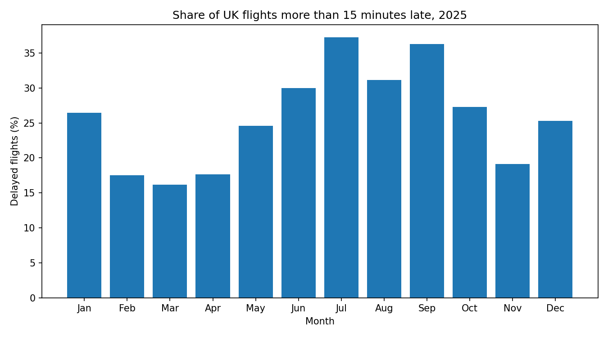

# UK airport delays by month

## Question

Which months have the highest share of delayed flights at UK airports?

## Data

- Source: UK Civil Aviation Authority, airport punctuality statistics
- Period: January 2025 to December 2025
- Link: https://www.caa.co.uk/data-and-analysis/uk-aviation-market/flight-punctuality/uk-flight-punctuality-statistics/2025/

## What I did

1. Loaded the CSV files with pandas and combined them into one table.
2. Dropped rows with zero matched flights.
3. Defined "delayed" as a flight more than 15 minutes late.
4. Grouped the data by month, and calculated the share of delayed flights in each month.
5. Plotted the results as a bar chart.

## Findings

- The highest percent of delays was in July at 37.6%. The lowest was in March at 16.4%.
- The June to September period had both the most flights and the highest share of delayed flights, between 30.2% and 37.6%.
- January was worse than expected for a winter month at 27.0% of flights were delayed, compared with 17.6% in February. The data can’t show why.
- Storm Éowyn hit on 24 January with red wind warnings in Scotland and Northern Ireland and led to hundreds of cancelled UK flights ([source](https://www.metoffice.gov.uk/blog/2025/a-look-back-on-storm-eowyn)). However, my calculations exclude cancelled flights so this might not tell the whole story and more analysis is needed.

## Limitations

- The data shows when delays happened, not why. I did not have weather or air traffic data.
- Data is aggregated by airline and route. I couldn't look at individual flights.
- This covers one year, so I can't say whether the pattern repeats.

## How to run it

1. Install the libraries: `pip install -r requirements.txt`
2. The data files are already in the data folder.
3. Run `python flight_data.py`. The chart is saved in `charts`.

## Next steps

- Add weather data and test whether it explains the January spike.
- Compare different airlines delay percentage against the average.

## Tools

Python, pandas, matplotlib
